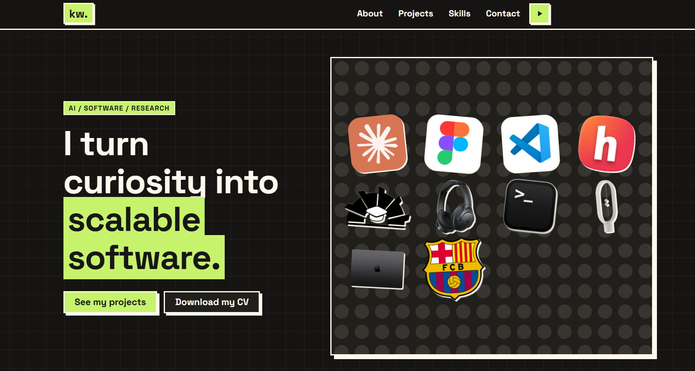

# Khaled Wael — Portfolio



A personal portfolio for **Khaled Wael**, an AI & software developer and STEM student from Damietta, Egypt. It showcases projects in computer vision, retrieval-augmented generation (RAG) and medical imaging, and is built with a **Neo-Brutalist** look: thick borders, hard shadows and bold colors.

Everything is plain **HTML, CSS and JavaScript**. No framework, no build step, no dependencies to install.

## Highlights

- **Interactive sticker board** in the hero section. Tools and things I love are stickers you can **drag, resize and rotate**, like a design canvas. Click one to see what it is. They start in a random, non-overlapping layout on every visit.
- **Auto-scrolling project showcase** that pauses on hover (or focus) so every card can be read. On touch devices and for users who prefer reduced motion, it becomes a normal horizontally scrollable row.
- **Background music toggle** in the navigation bar.
- **Working contact form** powered by [Web3Forms](https://web3forms.com), with a honeypot field against spam. No backend needed.
- **Light and dark themes** that follow the system setting automatically.
- **Scroll reveal animations** and numbered section headings.
- **Accessible by default**: skip link, semantic landmarks, ARIA labels, visible focus states, stickers that are real focusable buttons, and `prefers-reduced-motion` support.
- **Responsive** from small phones to wide desktop screens.

## Projects featured

| Project | What it is | Links |
|---|---|---|
| **Waey** | Open-source, screen-aware desktop AI assistant | [GitHub](https://github.com/khaled-dragon/Waey) · [Live](https://waey-ai.vercel.app/) |
| **AI Business Assistant** | PDF document assistant using RAG (FAISS, HuggingFace embeddings, Llama 3, Flask) | [GitHub](https://github.com/khaled-dragon/Business_AI_Assistant) · [Live](https://khaled-dragon.github.io/Business_AI_Assistant/) |
| **Leukocoria Detection** | Computer vision project for detecting leukocoria in eye images (YOLOv11, OpenCV) | [GitHub](https://github.com/khaled-dragon/Leukocoria_Detection) · [Live](https://khaled-dragon.github.io/Leukocoria_Detection/) |
| **OptiVerse AI** | Retinal imaging research: diabetic retinopathy detection, explainable AI, 3D reconstruction | [Live](https://optiverse-ai.vercel.app/) (source is private) |

## Tech stack

- **HTML5** with semantic structure.
- **CSS3**: custom properties (design tokens), Grid, Flexbox, `color-mix()`, individual transform properties (`translate`, `rotate`, `scale`), `clamp()` for fluid type and spacing.
- **Vanilla JavaScript**: Pointer Events (drag, resize, rotate), `IntersectionObserver` (reveal animations), `fetch` (contact form), the Audio API (music toggle).
- **Fonts**: [Space Grotesk](https://fonts.google.com/specimen/Space+Grotesk) and [Inter](https://fonts.google.com/specimen/Inter) from Google Fonts.

## Project structure

```
Portfolio/
├── index.html                  # all page content
├── css/
│   └── style.css               # design tokens (:root) + all styles
├── js/
│   └── script.js               # sticker board, marquee, music, form, animations
├── assets/
│   ├── Khaled_CV.pdf           # downloadable CV
│   ├── favicon-32.png
│   ├── apple-touch-icon.png
│   ├── audio/                  # background music
│   └── images/
│       ├── screenshot.png      # README preview
│       ├── projects/           # project card images
│       └── stickers/           # hero board stickers (SVG)
└── README.md
```

## Run locally

No installation needed. Either open `index.html` in your browser, or serve the folder with a local server:

```bash
# Python 3
python3 -m http.server 8000
# then open http://localhost:8000
```

A local server is recommended, because some browsers restrict audio and `fetch` requests on `file://` pages.

## Customize

| What | Where |
|---|---|
| Colors, borders, shadows, fonts | CSS variables at the top of `css/style.css` (`:root`) |
| Text, links, tags | `index.html` (each project is one `<article class="card">`) |
| Project card accent colors | the `.card--waey`, `.card--business`, ... rules in `css/style.css` |
| Hero stickers | the `.stk` buttons inside `#board` in `index.html` (`data-name`, `data-desc`, `--r` rotation, `--s` artwork scale) |
| Background music | replace `assets/audio/music.mp3` |

### Contact form setup

The form posts to [Web3Forms](https://web3forms.com). To use your own inbox:

1. Create a free access key at web3forms.com using your email address.
2. In `index.html`, replace the value of the hidden `access_key` input with your key.

Web3Forms access keys are designed to be public, so it is safe to keep the key in the page.

## Browser support

Built for modern evergreen browsers (recent Chrome, Edge, Firefox and Safari). Features such as `color-mix()` and the individual `translate` / `rotate` / `scale` properties need a reasonably recent version.

## Credits and notes

- Logos in the sticker board (Claude, Figma, VS Code, Hack Club, Barcelona FC and others) belong to their respective owners and are shown only to express the tools and interests of the author.

## Contact

- Email: [kwael6774@gmail.com](mailto:kwael6774@gmail.com)
- GitHub: [@khaled-dragon](https://github.com/khaled-dragon)
- LinkedIn: [khaledwael17](https://www.linkedin.com/in/khaledwael17)
